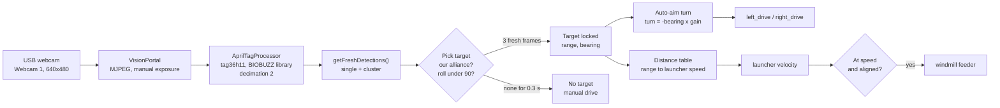

# FTC Camera Integration Plan (Java, FTC SDK)

**Robot:** goBILDA FTC StarterBot 2026-27 (BIOBUZZ) with our V3 shooter
**Prepared by:** Aarav J. and collaborators, Prolabs Robotics
**SDK:** FTC SDK v12.0 (the official 2026-27 release)
**Status:** Plan and starter code. **Not robot tested yet.** See the note at the end.

This plan shows how we can take the AprilTag ideas from our Python app `FTC-camera(v1).py` and put them on the real robot in Java, so the robot can aim and set shooter speed by itself.

---

## 1. Goal

| What we want | How the camera helps |
|---|---|
| Aim at our HIVE CELL | The camera finds the CELL's AprilTag cluster and tells us the angle to it (bearing) |
| Shoot from the right distance | The camera tells us the distance (range), and we pick the launcher speed from a table |
| Do it fast in TeleOp | Hold one button and the robot turns to face the target |
| Do it in Autonomous | Drive, line up with the camera, then shoot |

---

## 2. Python or Java? Why we need Java

Our `FTC-camera(v1).py` runs on a laptop. It uses OpenCV, `pupil_apriltags`, Tkinter and macOS voice. **None of that runs on the robot.**

| | `FTC-camera(v1).py` (laptop) | Robot code (this plan) |
|---|---|---|
| Runs on | Mac or PC | REV Control Hub (Android) |
| Language | Python | Java (or Blocks) on the FTC SDK |
| AprilTag library | `pupil_apriltags` (UMich C library) | FTC SDK `AprilTagProcessor` (built on the same AprilTag library) |
| Camera | Any laptop camera | USB webcam named `Webcam 1` |
| Output | Screen arrows and voice ("Left", "Stop", "Aligned") | Motor power to the drive and the launcher |
| Pose | Pixel position and screen angle only | Real distance and angles in inches and degrees |

So the Python app stays useful as a **laptop practice and test tool**, and the Java OpMode below is what goes on the robot.

---

## 3. Important game fact: BIOBUZZ uses tag **clusters**

We checked this against the official FTC docs ([AprilTag Clusters](https://ftc-docs.firstinspires.org/en/latest/tech_tips/tech-tips/tech-tip-apriltag-clusters/tech-tip-apriltag-clusters.html)):

- Each HIVE CELL has a **4-tag cluster on its underside**. Tags are family **tag36h11**.
- BIOBUZZ has **4 clusters and no single tags**. In SDK v12.0 the four cluster names are `RED SCORING`, `RED AUDIENCE`, `BLUE AUDIENCE` and `BLUE SCORING` (we read these from the SDK v12.0 `AprilTagGameDatabase`).
- From SDK v12.0, `getDetections()` returns two types: `AprilTagSingleDetection` and `AprilTagClusterDetection`. **We must check the type before reading fields.** Old code that reads `detection.id` will not compile.
- The cluster pose points to roughly the **center of the CELL opening**, not to a tag. This is great for aiming.
- To pick the right target, the docs suggest two checks:
  1. The cluster name starts with our alliance letter (`R` or `B`).
  2. `Math.abs(ftcPose.roll) < 90`, which means the cluster is right side up and the CELL is scorable.
- CELLs tip during the match, so the tags move. That means we should aim with the **relative pose** (`ftcPose`: range, bearing) and **not** trust field position (`robotPose`) from these tags.

Tag IDs and print files: check the Competition Manual and the Playing Field Resources page ([FTC game resources](https://ftc-resources.firstinspires.org/ftc/game/manual)) before printing practice tags. Print them at real size.

---

## 4. Hardware

### 4.1 Which webcam

From our [Camera buying Guide](./Camera%20buying%20Guide.md), checked against the SDK's built-in calibration list ([Camera Calibration](https://ftc-docs.firstinspires.org/en/latest/programming_resources/vision/camera_calibration/camera-calibration.html)):

| Webcam | Built-in SDK calibration? | Our view |
|---|---|---|
| **Logitech C920 HD Pro** | **Yes**, at 640x480 and more | **Best pick.** Works at 640x480 with no calibration work |
| Logitech C270 | Yes, at 640x480 | Good budget pick |
| Logitech Brio 100 | No | We would need to calibrate it ourselves first |
| BigPassport Pro-Live N3 | No | Bench testing only |

One honest change to the buying guide: the Brio 100 is cheaper, but it is not on the SDK calibration list, so range numbers can be wrong until we calibrate it. If the budget allows, the C920 saves us that work. The C920 also has autofocus. If focus hunting causes jumpy readings, we can lock focus with the SDK `FocusControl` ([Webcam Controls](https://ftc-docs.firstinspires.org/en/latest/programming_resources/vision/webcam_controls/index.html)).

### 4.2 Where to mount it

| Item | Plan | Why |
|---|---|---|
| Direction | Face the **same way the V3 shooter fires** | The roll check above assumes this, and aim error then equals shooter error |
| Side to side | On the robot's center line, close to the shooter | Then bearing 0 means the shooter points at the target. If not centered, we set `BEARING_OFFSET_DEG` |
| Height | Low and protected, for example 150 to 250 mm from the floor (check on robot) | Away from balls and other robots |
| Tilt | Tilt **up**, start around 20 to 30 degrees (check on robot) | The tags are on the **underside** of the CELL, so a flat camera may miss them |
| Mount | Rigid printed or metal bracket, 100% infill, 2 screws minimum | Any wobble changes the angle and ruins aim |

Check: from every spot we want to shoot from, the cluster must stay fully inside the camera preview.

### 4.3 Wiring

- Plug the webcam into the Control Hub **USB 3.0 port** (the blue one). The FTC docs warn that ESD on the USB 2.0 port can cause Wi-Fi disconnects ([Configuring an External Webcam](https://ftc-docs.firstinspires.org/en/latest/hardware_and_software_configuration/configuring/configuring_external_webcam/configuring-external-webcam.html)).
- Zip tie the cable to the frame every 10 to 15 cm, with a small loop of slack at the camera and at the hub so a hit does not pull the plug.
- Keep the cable away from the launcher wheel and the intake.
- If we ever add a second camera, use a USB hub on the USB 3.0 port. A C920 may need a powered hub.

### 4.4 Robot configuration

On the Driver Hub: **Configure Robot, Scan**. The webcam should appear as `Webcam 1`. Keep that exact name. The motor and servo names in our code match goBILDA's StarterBot example: `left_drive`, `right_drive`, `intake`, `launcher`, `windmill`, `left_intake_servo`, `right_intake_servo`.

---

## 5. Software architecture



| Part | What it does | Key settings |
|---|---|---|
| `VisionPortal` | Opens the webcam and sends frames to processors | 640x480, MJPEG stream format to save USB bandwidth ([CPU and Bandwidth](https://ftc-docs.firstinspires.org/en/latest/apriltag/vision_portal/visionportal_cpu_and_bandwidth/visionportal-cpu-and-bandwidth.html)) |
| `AprilTagProcessor` | Finds tags and works out pose | tag36h11, `getCurrentGameTagLibrary()`, inches and degrees |
| Lens intrinsics | Camera "shape" numbers (fx, fy, cx, cy) needed for correct distance | Built in for C920 and C270 at 640x480. Otherwise `setLensIntrinsics(...)` from our own calibration |
| Camera pose | Where the camera sits on the robot | Only needed for `robotPose` (field position) with `setCameraPose(...)`. We do not need it for aiming, see section 3 |
| Decimation | Shrinks the image before tag search | Higher is faster, lower sees farther. The official sample says decimation 3 still finds a 5 inch tag at 10 feet at 30 FPS on a C920. Start at 2 |
| Exposure and gain | Short exposure stops motion blur while turning | Start at 6 ms exposure, gain 250 (official sample values), then tune with `ConceptAprilTagOptimizeExposure` |

The pose values we use are explained in [Understanding AprilTag Detection Values](https://ftc-docs.firstinspires.org/en/latest/apriltag/understanding_apriltag_detection_values/understanding-apriltag-detection-values.html):

| Value | Meaning | We use it for |
|---|---|---|
| `range` | Straight distance from camera to target (inches) | Launcher speed |
| `bearing` | Angle to turn to face the target. Positive means the target is to the **left** | Auto-aim turn |
| `yaw` | How twisted the target is from facing us | Optional: lining up square in Autonomous |
| `roll` | Rotation of the cluster in the image | Skip upside down CELLs |

---

## 6. How the Python v1 logic maps to Java

| Python v1 (`FTC-camera(v1).py`) | Java on the robot |
|---|---|
| `Detector(families="tag36h11", quad_decimate=1.5)` | `AprilTagProcessor.Builder().setTagFamily(TAG_36h11)` and `setDecimation(2)` |
| `cv2.VideoCapture` camera probe | `VisionPortal.Builder().setCamera(hardwareMap.get(WebcamName.class, "Webcam 1"))` |
| Darkened second pass (`DARKEN` gamma LUT) for glare | Manual exposure and gain with `ExposureControl` and `GainControl` |
| Filter `hamming <= 1` and `decision_margin >= 15` | SDK filters for us. For singles we can read `.hamming` and `.decisionMargin`. For clusters, use `percentClusterFound` |
| Target = tag closest to screen center | Target = our alliance cluster, right side up, most tags seen |
| `dx`, `dy` in pixels, `up_err` angle on screen | `ftcPose.bearing` and `ftcPose.range` in real units |
| Commands 1 to 7 (LEFT, RIGHT, FRONT, BACK, ROTATE CW, ROTATE CCW, STOP) | Motor power: `turn = -bearing x TURN_GAIN`, clipped |
| Hysteresis (`tin`/`tout`, 15/20 degree thresholds) | `AIM_TOLERANCE_DEG` deadband: stop turning when inside it |
| Debounce: same command 3 frames in a row | `FRAMES_TO_CONFIRM = 3` using `getFreshDetections()` so each frame counts once |
| `GUIDE_MAX_AGE = 1.0` s | `TARGET_TIMEOUT_S = 0.3` s (shorter, because a moving robot should not act on old data) |
| Optical flow prediction for 5 s | Not ported. On a robot, guessing for 5 s is risky. We stop auto-aim when the target is lost |
| Mirrored image detection | Not needed. The webcam image is not mirrored |
| Voice "Aligned" | Telemetry shows `ALIGNED`. Optional: `gamepad1.rumble(200)` |

---

## 7. Step by step phases

| Phase | What we do | Check before moving on |
|---|---|---|
| **0. Setup** | Install FTC SDK v12.0 (Android Studio) or use OnBot Java. Update the Control Hub and Driver Hub | `ConceptAprilTag` builds and shows in the OpMode list |
| **1. Mount and wire** | Mount the camera (section 4.2), plug into USB 3.0, configure `Webcam 1` | Camera Stream shows a clear, steady image on the Driver Hub |
| **2. Bench test** | Run sample `ConceptAprilTag` (enable it by removing `@Disabled`). Hold a printed tag in front of the camera | ID or cluster name shows, with XYZ, PRY and RBE values. Updates smoothly |
| **3. Calibrate** | Use 640x480 on a C920 or C270. Run `ConceptAprilTagOptimizeExposure` and pick the shortest exposure that still detects. Try decimation 1, 2, 3 | No calibration warning on the preview. Tag still detected while the robot turns at medium speed |
| **4. Read range and bearing** | Place the tag at 24, 36, 48 and 72 inches. Measure with a tape | Range within about 1 to 2 inches. Bearing about 0 when centered, positive when the tag is to the left |
| **5. TeleOp auto-aim** | Load `CameraAimTeleOp.java`. Robot on blocks first, then on the floor. Hold LB | Robot turns toward the target and stops inside 2 degrees without shaking. If it shakes, lower `TURN_GAIN` |
| **6. Distance table** | Shoot 5 balls at each distance. Change launcher speed until most score. Write the speed in `TABLE_VELOCITY` | At least 4 of 5 shots score at each table distance |
| **7. Autonomous align then shoot** | Copy the aim and table code into an Autonomous OpMode: drive to the shooting spot, turn until aligned (with a time limit, for example 1.5 s), spin up, feed | Works 4 times out of 5 from the start position, and the time limit stops it if no tag is found |

### Tuning tips

- Change **one** number at a time and write down what happened.
- If auto-aim turns the wrong way, flip the sign in `rotate = -aimError * TURN_GAIN`.
- The table is only as good as the battery. Test with a charged battery, and recheck with a half charged one.

---

## 8. Java starter OpMode

Saved as [`CameraAimTeleOp.java`](./CameraAimTeleOp.java) in this folder. Copy it to `TeamCode/src/main/java/org/firstinspires/ftc/teamcode/`.

We compiled this file against the official FTC SDK v12.0 libraries (`RobotCore`, `Hardware`, `Vision` 12.0.0 from Maven) with no errors. It has **not** been run on a robot yet.

Controls (same as goBILDA's TeleOp, plus LB):

| Control | Action |
|---|---|
| Left stick Y | Drive forward and back |
| Right stick X | Turn |
| Left bumper (hold) | Auto-aim at our CELL |
| Right bumper (hold) | Spin launcher to the table speed, feed when ready |
| Right trigger / left trigger | Intake in / out |

```java
/*
 * CameraAimTeleOp.java
 * Prolabs Robotics, FTC Bangalore Resources (Aarav J. and collaborators)
 *
 * Starter TeleOp for the goBILDA FTC StarterBot 2026-27 (BIOBUZZ) with the V3 shooter
 * and one USB webcam named "Webcam 1".
 *
 * What it does:
 *   1. Finds our alliance HIVE CELL AprilTag cluster with the FTC SDK VisionPortal
 *      and AprilTagProcessor (tag36h11, SDK 12.0 or newer).
 *   2. Hold LEFT BUMPER: the robot turns by itself to face the cell opening (auto-aim assist).
 *      The driver still controls forward and back with the left stick.
 *   3. Hold RIGHT BUMPER: the launcher spins up. Its speed comes from a distance table,
 *      using the range the camera measured. The feeder only runs when the launcher is at
 *      speed (and, while aiming, only when the robot is lined up).
 *
 * Built from the official FTC SDK samples ConceptAprilTag, ConceptAprilTagOptimizeExposure
 * and RobotAutoDriveToAprilTagTank, and from goBILDA's BioBuzzStarterBotTeleop example.
 * Hardware names match goBILDA's example code.
 *
 * IMPORTANT: NOT ROBOT TESTED YET. Every number marked TUNE is a starting guess.
 * Test on blocks with the wheels off the ground first.
 *
 * Put this file in TeamCode/src/main/java/org/firstinspires/ftc/teamcode/
 */
package org.firstinspires.ftc.teamcode;

import android.util.Size;

import com.qualcomm.robotcore.eventloop.opmode.LinearOpMode;
import com.qualcomm.robotcore.eventloop.opmode.TeleOp;
import com.qualcomm.robotcore.hardware.CRServo;
import com.qualcomm.robotcore.hardware.DcMotor;
import com.qualcomm.robotcore.hardware.DcMotorEx;
import com.qualcomm.robotcore.hardware.DcMotorSimple;
import com.qualcomm.robotcore.hardware.PIDFCoefficients;
import com.qualcomm.robotcore.util.ElapsedTime;
import com.qualcomm.robotcore.util.Range;

import org.firstinspires.ftc.robotcore.external.hardware.camera.WebcamName;
import org.firstinspires.ftc.robotcore.external.hardware.camera.controls.ExposureControl;
import org.firstinspires.ftc.robotcore.external.hardware.camera.controls.GainControl;
import org.firstinspires.ftc.robotcore.external.navigation.AngleUnit;
import org.firstinspires.ftc.robotcore.external.navigation.DistanceUnit;
import org.firstinspires.ftc.vision.VisionPortal;
import org.firstinspires.ftc.vision.apriltag.AprilTagClusterDetection;
import org.firstinspires.ftc.vision.apriltag.AprilTagDetection;
import org.firstinspires.ftc.vision.apriltag.AprilTagGameDatabase;
import org.firstinspires.ftc.vision.apriltag.AprilTagProcessor;
import org.firstinspires.ftc.vision.apriltag.AprilTagSingleDetection;

import java.util.List;
import java.util.concurrent.TimeUnit;

@TeleOp(name = "Camera Aim TeleOp (V3 shooter)", group = "Prolabs")
public class CameraAimTeleOp extends LinearOpMode {

    // ---------------- Match settings ----------------
    /** Set before each match. true = RED alliance, false = BLUE alliance. */
    static final boolean RED_ALLIANCE = true;

    /**
     * Bench test mode. true = also accept single tags that are in the SDK library
     * (for example the sample tags 583 to 586) so we can test at a desk without a HIVE.
     * Set to false for matches.
     */
    static final boolean ALLOW_SINGLE_TAGS_FOR_BENCH_TEST = true;

    // ---------------- Camera settings ----------------
    static final String WEBCAM_NAME = "Webcam 1";        // must match the robot configuration
    static final int CAMERA_WIDTH = 640;                 // 640x480 has a built-in SDK calibration
    static final int CAMERA_HEIGHT = 480;                //   for the Logitech C920 and C270
    static final float DECIMATION = 2;                   // TUNE: 1 = longer range, 3 = faster
    static final boolean USE_MANUAL_EXPOSURE = true;     // short exposure = less motion blur
    static final int EXPOSURE_MS = 6;                    // TUNE: value from the official sample
    static final int GAIN = 250;                         // TUNE: raise if the image is too dark

    // ---------------- Aim settings (Python v1 ideas, in Java) ----------------
    static final double TURN_GAIN = 0.01;                // TUNE: turn power per degree of error
    static final double MAX_AUTO_TURN = 0.30;            // TUNE: cap on auto turn power
    static final double AIM_TOLERANCE_DEG = 2.0;         // TUNE: "aligned" if error is inside this
    static final double BEARING_OFFSET_DEG = 0.0;        // TUNE: if the camera is not on the shot line
    static final int FRAMES_TO_CONFIRM = 3;              // v1 debounce: need 3 fresh frames in a row
    static final double TARGET_TIMEOUT_S = 0.30;         // v1 GUIDE_MAX_AGE idea: forget old targets

    // ---------------- Launcher settings ----------------
    static final double LAUNCHER_DEFAULT_VELOCITY = 1250; // goBILDA example value (ticks per second)
    static final double LAUNCHER_TOLERANCE = 50;          // TUNE: "at speed" window (ticks per second)

    /**
     * Distance table: camera range (inches) to launcher velocity (ticks per second).
     * EXAMPLE NUMBERS ONLY. Fill these in from real test shots (see the plan, Phase 6).
     * Keep the ranges in increasing order.
     */
    static final double[] TABLE_RANGE_IN  = {  24,   36,   48,   60,   72 };
    static final double[] TABLE_VELOCITY  = { 1150, 1200, 1250, 1320, 1400 };

    // ---------------- Hardware ----------------
    private DcMotor leftDrive, rightDrive, intake;
    private DcMotorEx launcher;
    private CRServo windmillServo, leftIntakeServo, rightIntakeServo;

    // ---------------- Vision ----------------
    private VisionPortal visionPortal;
    private AprilTagProcessor aprilTag;

    // ---------------- Target state ----------------
    private boolean targetLocked = false;     // true after FRAMES_TO_CONFIRM fresh frames in a row
    private int framesSeen = 0;
    private String targetName = "none";
    private double targetRange = 0;           // inches, camera to target
    private double targetBearing = 0;         // degrees, + means target is to the LEFT
    private double targetRoll = 0;            // degrees, used to skip upside down cells
    private int targetPercentFound = 0;
    private final ElapsedTime sinceLastSeen = new ElapsedTime();

    @Override
    public void runOpMode() {
        initHardware();
        initAprilTag();
        if (USE_MANUAL_EXPOSURE) {
            setManualExposure(EXPOSURE_MS, GAIN);
        }

        telemetry.addData("Alliance", RED_ALLIANCE ? "RED" : "BLUE");
        telemetry.addData("Camera preview", "3 dots menu, Camera Stream");
        telemetry.addData(">", "Touch START");
        telemetry.update();
        waitForStart();

        while (opModeIsActive()) {
            updateTarget();

            // ----- Drive (same arcade style as goBILDA's TeleOp) -----
            double forward = -gamepad1.left_stick_y;
            double rotate = gamepad1.right_stick_x;            // + turns right (clockwise)
            boolean aiming = gamepad1.left_bumper;
            double aimError = targetBearing - BEARING_OFFSET_DEG;
            boolean aligned = targetLocked && Math.abs(aimError) < AIM_TOLERANCE_DEG;

            if (aiming && targetLocked) {
                // bearing + means target is LEFT, so we turn left (negative rotate).
                rotate = Range.clip(-aimError * TURN_GAIN, -MAX_AUTO_TURN, MAX_AUTO_TURN);
                if (aligned) {
                    rotate = 0;                                // v1 "STOP / Aligned"
                }
            }
            arcadeDrive(forward, rotate);

            // ----- Intake -----
            double intakePower = gamepad1.right_trigger - gamepad1.left_trigger;

            // ----- Launcher -----
            double targetVelocity = targetLocked ? velocityForRange(targetRange)
                                                 : LAUNCHER_DEFAULT_VELOCITY;
            boolean atSpeed = false;
            if (gamepad1.right_bumper) {
                launcher.setVelocity(targetVelocity);
                atSpeed = Math.abs(launcher.getVelocity() - targetVelocity) < LAUNCHER_TOLERANCE;
            } else {
                launcher.setVelocity(0);
            }

            boolean okToFeed = gamepad1.right_bumper && atSpeed && (!aiming || aligned);
            if (okToFeed) {
                windmillServo.setPower(1);
                intakePower += 0.5;                            // same push as goBILDA's code
            } else {
                windmillServo.setPower(0);
            }
            intakePower = Range.clip(intakePower, -1, 1);
            intake.setPower(intakePower);
            leftIntakeServo.setPower(intakePower);
            rightIntakeServo.setPower(intakePower);

            // ----- Telemetry -----
            telemetry.addData("Target", targetLocked ? targetName : "none (drive to find one)");
            if (targetLocked) {
                telemetry.addData("Range", "%5.1f in", targetRange);
                telemetry.addData("Bearing", "%5.1f deg (error %5.1f)", targetBearing, aimError);
                telemetry.addData("Roll", "%5.1f deg", targetRoll);
                telemetry.addData("Tags seen", "%d %%", targetPercentFound);
            }
            telemetry.addData("Aim", aiming ? (aligned ? "ALIGNED" : "turning") : "manual (hold LB)");
            telemetry.addData("Launcher", "%4.0f / %4.0f %s", launcher.getVelocity(), targetVelocity,
                    atSpeed ? "AT SPEED" : "");
            telemetry.update();

            sleep(10);
        }

        visionPortal.close();
    }

    /** Reads new detections, picks the best target, and keeps a short memory of it. */
    private void updateTarget() {
        // getFreshDetections() returns null if no new frame was processed since the last call.
        // This keeps our "3 frames in a row" count honest.
        List<AprilTagDetection> fresh = aprilTag.getFreshDetections();
        if (fresh != null) {
            AprilTagDetection best = null;
            int bestPercent = -1;
            String bestName = "none";

            for (AprilTagDetection detection : fresh) {
                if (detection.ftcPose == null) {
                    continue;                                  // no pose, cannot aim at it
                }
                if (detection instanceof AprilTagClusterDetection) {
                    AprilTagClusterDetection cluster = (AprilTagClusterDetection) detection;
                    String name = cluster.metadata.name;       // "RED SCORING", "BLUE AUDIENCE", ...
                    boolean ourAlliance = RED_ALLIANCE ? name.startsWith("R") : name.startsWith("B");
                    boolean rightSideUp = Math.abs(detection.ftcPose.roll) < 90; // scorable cell
                    if (!ourAlliance || !rightSideUp) {
                        continue;
                    }
                    // Prefer the cluster with more tags visible, then the closer one.
                    if (cluster.percentClusterFound > bestPercent
                            || (cluster.percentClusterFound == bestPercent && best != null
                                && detection.ftcPose.range < best.ftcPose.range)) {
                        best = detection;
                        bestPercent = cluster.percentClusterFound;
                        bestName = name;
                    }
                } else if (ALLOW_SINGLE_TAGS_FOR_BENCH_TEST
                        && detection instanceof AprilTagSingleDetection) {
                    AprilTagSingleDetection single = (AprilTagSingleDetection) detection;
                    if (single.metadata != null && best == null) {
                        best = detection;
                        bestPercent = 0;
                        bestName = "bench tag " + single.id;
                    }
                }
            }

            if (best != null) {
                framesSeen++;
                targetName = bestName;
                targetRange = best.ftcPose.range;
                targetBearing = best.ftcPose.bearing;
                targetRoll = best.ftcPose.roll;
                targetPercentFound = bestPercent;
                sinceLastSeen.reset();
                if (framesSeen >= FRAMES_TO_CONFIRM) {
                    targetLocked = true;
                }
            } else {
                framesSeen = 0;
            }
        }

        // Forget the target if we have not seen it for a short time.
        if (sinceLastSeen.seconds() > TARGET_TIMEOUT_S) {
            targetLocked = false;
            framesSeen = 0;
            targetName = "none";
        }
    }

    /** Straight-line interpolation in the distance table, clamped at both ends. */
    private double velocityForRange(double rangeIn) {
        int last = TABLE_RANGE_IN.length - 1;
        if (rangeIn <= TABLE_RANGE_IN[0]) return TABLE_VELOCITY[0];
        if (rangeIn >= TABLE_RANGE_IN[last]) return TABLE_VELOCITY[last];
        for (int i = 0; i < last; i++) {
            double r0 = TABLE_RANGE_IN[i], r1 = TABLE_RANGE_IN[i + 1];
            if (rangeIn <= r1) {
                double t = (rangeIn - r0) / (r1 - r0);
                return TABLE_VELOCITY[i] + t * (TABLE_VELOCITY[i + 1] - TABLE_VELOCITY[i]);
            }
        }
        return LAUNCHER_DEFAULT_VELOCITY;
    }

    private void arcadeDrive(double forward, double rotate) {
        double left = forward + rotate;
        double right = forward - rotate;
        double max = Math.max(1.0, Math.max(Math.abs(left), Math.abs(right)));
        leftDrive.setPower(left / max);
        rightDrive.setPower(right / max);
    }

    private void initHardware() {
        // Names match goBILDA's BIOBUZZ StarterBot example code and robot configuration.
        leftDrive = hardwareMap.get(DcMotor.class, "left_drive");
        rightDrive = hardwareMap.get(DcMotor.class, "right_drive");
        intake = hardwareMap.get(DcMotor.class, "intake");
        launcher = hardwareMap.get(DcMotorEx.class, "launcher");
        windmillServo = hardwareMap.get(CRServo.class, "windmill");
        leftIntakeServo = hardwareMap.get(CRServo.class, "left_intake_servo");
        rightIntakeServo = hardwareMap.get(CRServo.class, "right_intake_servo");

        leftDrive.setDirection(DcMotor.Direction.FORWARD);
        rightDrive.setDirection(DcMotor.Direction.REVERSE);
        leftDrive.setZeroPowerBehavior(DcMotor.ZeroPowerBehavior.BRAKE);
        rightDrive.setZeroPowerBehavior(DcMotor.ZeroPowerBehavior.BRAKE);

        launcher.setZeroPowerBehavior(DcMotor.ZeroPowerBehavior.BRAKE);
        launcher.setMode(DcMotor.RunMode.RUN_USING_ENCODER);
        launcher.setPIDFCoefficients(DcMotor.RunMode.RUN_USING_ENCODER,
                new PIDFCoefficients(40, 0, 0, 12.5));          // goBILDA example values

        rightIntakeServo.setDirection(DcMotorSimple.Direction.REVERSE);
        windmillServo.setDirection(DcMotorSimple.Direction.REVERSE);
    }

    private void initAprilTag() {
        aprilTag = new AprilTagProcessor.Builder()
                .setTagFamily(AprilTagProcessor.TagFamily.TAG_36h11)
                .setTagLibrary(AprilTagGameDatabase.getCurrentGameTagLibrary())
                .setOutputUnits(DistanceUnit.INCH, AngleUnit.DEGREES)
                .setDrawTagOutline(true)
                // Only needed if our camera or resolution is NOT in the SDK's built-in list.
                // Values are fx, fy, cx, cy from our own calibration:
                // .setLensIntrinsics(578.272, 578.272, 402.145, 221.506)
                .build();
        aprilTag.setDecimation(DECIMATION);

        visionPortal = new VisionPortal.Builder()
                .setCamera(hardwareMap.get(WebcamName.class, WEBCAM_NAME))
                .setCameraResolution(new Size(CAMERA_WIDTH, CAMERA_HEIGHT))
                .setStreamFormat(VisionPortal.StreamFormat.MJPEG)   // less USB bandwidth
                .addProcessor(aprilTag)
                .build();
    }

    /** Short exposure and higher gain to cut motion blur. Same steps as the official sample. */
    private void setManualExposure(int exposureMS, int gain) {
        if (visionPortal == null) return;

        while (!isStopRequested()
                && visionPortal.getCameraState() != VisionPortal.CameraState.STREAMING) {
            telemetry.addData("Camera", "Waiting for stream");
            telemetry.update();
            sleep(20);
        }
        if (isStopRequested()) return;

        ExposureControl exposureControl = visionPortal.getCameraControl(ExposureControl.class);
        if (exposureControl.getMode() != ExposureControl.Mode.Manual) {
            exposureControl.setMode(ExposureControl.Mode.Manual);
            sleep(50);
        }
        exposureControl.setExposure((long) exposureMS, TimeUnit.MILLISECONDS);
        sleep(20);
        GainControl gainControl = visionPortal.getCameraControl(GainControl.class);
        gainControl.setGain(gain);
        sleep(20);
        telemetry.addData("Camera", "Ready");
        telemetry.update();
    }
}
```

---

## 9. Testing checklist

- [ ] Camera shows as `Webcam 1` and Camera Stream is clear
- [ ] Camera is in the USB 3.0 port and the cable is zip tied with slack loops
- [ ] Camera mount does not move when pushed by hand
- [ ] `ConceptAprilTag` detects a printed tag (single) and, on a field, a CELL cluster
- [ ] No calibration warning at 640x480
- [ ] Range checked with a tape at 4 distances
- [ ] Bearing sign checked (positive = left)
- [ ] Only our alliance clusters are picked (test with both `RED_ALLIANCE` values)
- [ ] Upside down CELL is skipped (roll check)
- [ ] Auto-aim stops inside the tolerance without shaking
- [ ] Feeder does not run when the launcher is below speed
- [ ] Distance table filled with real numbers
- [ ] `ALLOW_SINGLE_TAGS_FOR_BENCH_TEST` set to `false` for matches
- [ ] Tested with a full and a half charged battery

---

## 10. Common problems and fixes

| Problem | Likely cause | Fix |
|---|---|---|
| OpMode crashes at INIT: "Webcam 1 not found" | Name or configuration wrong | Rescan in Configure Robot, name it exactly `Webcam 1`, activate the config |
| Old AprilTag code does not compile | SDK v12.0 split detections into two types | Check `instanceof AprilTagSingleDetection` or `AprilTagClusterDetection` before reading `.id` or `.metadata` |
| Tags seen but range is wrong | No calibration for this camera or resolution | Use C920 or C270 at 640x480, or calibrate and use `setLensIntrinsics` |
| Tags lost while turning | Motion blur | Lower exposure, raise gain, or turn slower (`MAX_AUTO_TURN`) |
| Tags only found close up | Decimation too high, or camera tilted wrong | Decimation 2 or 1, tilt the camera up more |
| Low frame rate, laggy robot | Too much resolution or preview load | 640x480, MJPEG, and turn off the preview during matches |
| Wi-Fi drops during matches | Camera on USB 2.0 port, ESD | Move to the USB 3.0 port, follow FTC ESD advice |
| Robot shakes left and right when aiming | `TURN_GAIN` too high | Lower it, or widen `AIM_TOLERANCE_DEG` a little |
| Robot turns away from the target | Sign or motor direction flipped | Flip the sign of `rotate` in auto-aim, or check motor directions |
| Aims at the wrong CELL | Wrong alliance setting | Set `RED_ALLIANCE` before the match |
| C920 readings jump | Autofocus hunting | Lock focus with `FocusControl` |

---

## 11. Honest note: not robot tested

We wrote this plan and code from the official FTC docs and samples, and we compiled the Java against SDK v12.0. **We have not run it on a robot or a BIOBUZZ field yet.** These parts are guesses until we test:

- Camera height and tilt (tags are under the CELL, so tilt matters a lot)
- `TURN_GAIN`, `AIM_TOLERANCE_DEG`, exposure and gain
- Every number in the distance table (the ones in the code are examples only)
- How the V3 shooter's real shot direction lines up with the camera

If you test it, please share what worked and what did not, so we can update this plan together.

---

## 12. Sources

| Source | Used for |
|---|---|
| [FTC Docs: AprilTag Clusters (SDK 12.0, BIOBUZZ)](https://ftc-docs.firstinspires.org/en/latest/tech_tips/tech-tips/tech-tip-apriltag-clusters/tech-tip-apriltag-clusters.html) | Clusters, target choice, roll check, code changes |
| [FTC Docs: AprilTag Introduction](https://ftc-docs.firstinspires.org/en/latest/apriltag/vision_portal/apriltag_intro/apriltag-intro.html) | AprilTag basics |
| [FTC Docs: VisionPortal Overview](https://ftc-docs.firstinspires.org/en/latest/apriltag/vision_portal/visionportal_overview/visionportal-overview.html) | VisionPortal setup |
| [FTC Docs: Understanding AprilTag Detection Values](https://ftc-docs.firstinspires.org/en/latest/apriltag/understanding_apriltag_detection_values/understanding-apriltag-detection-values.html) | Range, bearing, yaw meaning |
| [FTC Docs: Camera Calibration](https://ftc-docs.firstinspires.org/en/latest/programming_resources/vision/camera_calibration/camera-calibration.html) | Built-in calibration list |
| [FTC Docs: VisionPortal CPU and Bandwidth](https://ftc-docs.firstinspires.org/en/latest/apriltag/vision_portal/visionportal_cpu_and_bandwidth/visionportal-cpu-and-bandwidth.html) | Resolution, MJPEG, preview load |
| [FTC Docs: Webcam Controls](https://ftc-docs.firstinspires.org/en/latest/programming_resources/vision/webcam_controls/index.html) | Exposure, gain, focus |
| [FTC Docs: Configuring an External Webcam](https://ftc-docs.firstinspires.org/en/latest/hardware_and_software_configuration/configuring/configuring_external_webcam/configuring-external-webcam.html) | USB 3.0 port, `Webcam 1` |
| [FTC Docs: AprilTag Localization](https://ftc-docs.firstinspires.org/en/latest/apriltag/vision_portal/apriltag_localization/apriltag-localization.html) | Camera pose and `robotPose` |
| [FTC SDK sample: ConceptAprilTag.java](https://github.com/FIRST-Tech-Challenge/FtcRobotController/blob/master/FtcRobotController/src/main/java/org/firstinspires/ftc/robotcontroller/external/samples/ConceptAprilTag.java) | Processor and portal setup |
| [FTC SDK sample: ConceptAprilTagOptimizeExposure.java](https://github.com/FIRST-Tech-Challenge/FtcRobotController/blob/master/FtcRobotController/src/main/java/org/firstinspires/ftc/robotcontroller/external/samples/ConceptAprilTagOptimizeExposure.java) | Exposure tuning |
| [FTC SDK sample: RobotAutoDriveToAprilTagTank.java](https://github.com/FIRST-Tech-Challenge/FtcRobotController/blob/master/FtcRobotController/src/main/java/org/firstinspires/ftc/robotcontroller/external/samples/RobotAutoDriveToAprilTagTank.java) | Turn gain, tank drive aiming |
| [FTC SDK sample: RobotAutoDriveToAprilTagOmni.java](https://github.com/FIRST-Tech-Challenge/FtcRobotController/blob/master/FtcRobotController/src/main/java/org/firstinspires/ftc/robotcontroller/external/samples/RobotAutoDriveToAprilTagOmni.java) | Same idea for mecanum robots |
| [FTC SDK v12.0 release](https://github.com/FIRST-Tech-Challenge/FtcRobotController/releases/tag/v12.0) | Official 2026-27 SDK |
| [goBILDA FTC StarterBot Resource Guide 2026-27](https://www.gobilda.com/ftc-starter-bot-resource-guide-2026-2027-season/) | Hardware names, launcher velocity and PIDF from the example code |
| [FTC Competition Manual and game resources](https://ftc-resources.firstinspires.org/ftc/game/manual) | Tag IDs, sizes, print files |
