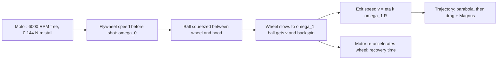

# Shooter Trajectory Calculations

By Aarav J.

This is the maths companion to [FTC_Shooting_and_Intake_Mechanism.pdf](./FTC_Shooting_and_Intake_Mechanism.pdf). The PDF explains *why* we make every shooting variable a constant. This page works out *what those constants should be*, from Newton's laws all the way to air drag, backspin and shooting while the robot moves.

> **Assumed values are flagged.** Anything marked **(assumed)** is a reasonable FTC-like number, not a measured one. Measure your own robot and replace it. The CELL opening size (about 20 x 12 in) and the POLLEN mass are approximate.

---

## Contents

1. [Problem](#1-problem)
2. [Investigation](#2-investigation)
   - [2.1 Symbols and parameters](#21-symbols-and-parameters)
   - [2.2 Projectile motion from Newton's laws](#22-projectile-motion-from-newtons-laws)
   - [2.3 Apex, time of flight, range and impact angle](#23-apex-time-of-flight-range-and-impact-angle)
   - [2.4 Launch speed for a given target and hood angle](#24-launch-speed-for-a-given-target-and-hood-angle)
   - [2.5 Hood angle for a given speed](#25-hood-angle-for-a-given-speed)
   - [2.6 Entry angle, the CELL window and error propagation](#26-entry-angle-the-cell-window-and-error-propagation)
   - [2.7 Flywheel to ball exit speed](#27-flywheel-to-ball-exit-speed)
   - [2.8 Air drag and the Magnus effect](#28-air-drag-and-the-magnus-effect)
   - [2.9 Shooting while moving](#29-shooting-while-moving)
3. [Solution](#3-solution)
   - [3.1 Worked example](#31-worked-example)
   - [3.2 Python 3.13: solve for angle and speed](#32-python-313-solve-for-angle-and-speed)
   - [3.3 Python 3.13: RK4 with drag and backspin](#33-python-313-rk4-with-drag-and-backspin)
   - [3.4 What to change on the robot](#34-what-to-change-on-the-robot)
4. [Sources](#4-sources)

---

## 1. Problem

The PDF picks the hood angle with a straight line:

$$
\theta = \arctan\left(\frac{VD}{HD}\right) = \arctan\left(\frac{30.6}{72}\right) \approx 23.0^\circ \;\to\; 25^\circ
$$

and uses a launch speed of 20 km/h (about 5.56 m/s). Two things are missing:

1. **Gravity.** A ball never travels in a straight line. It follows a parabola, so aiming the hood straight at the CELL always lands low.
2. **Launch height.** 30.6 in is measured from the floor tiles. The ball leaves the shooter some height above the floor, so the real vertical rise is smaller.

If you put the PDF's numbers into the equations below (launch height 12 in, assumed), the ball is only about **20.1 in** above the floor when it reaches 72 in. It never reaches the 30.6 in bottom edge of the CELL. The shooter needs either much more speed at 25 degrees, or a steeper hood. The rest of this page works out exactly how much, and how accurate each part has to be.

---

## 2. Investigation

### 2.1 Symbols and parameters

| Symbol | Meaning | Value used | Status |
|---|---|---|---|
| $g$ | Gravity | 9.81 m/s² | Standard |
| $\Delta x$ | Horizontal distance, shooter exit to CELL face | 72 in = 1.8288 m | From the PDF |
| $h_0$ | Launch (exit) height above the tiles | 12 in = 0.3048 m | **(assumed)** |
| $y_c$ | Aim point: CELL bottom 30.6 in + half of 12 in opening | 36.6 in = 0.9296 m | Opening size **approximate** |
| $\Delta h$ | Vertical rise, $y_c - h_0$ | 24.6 in = 0.6248 m | Derived |
| $W \times H$ | CELL opening, width x height | 20 x 12 in | **approximate** |
| $d_b,\ r_b$ | POLLEN diameter, radius | 71 mm (about 2.8 in), 35.5 mm | From the V3 BOM |
| $m$ | POLLEN mass | 0.050 kg (also tested 0.025 and 0.075) | **(assumed)** |
| $\rho$ | Air density, Bengaluru (about 920 m altitude) | 1.10 kg/m³ | **(assumed)**, barometric formula |
| $C_d$ | Sphere drag coefficient, subcritical $Re$ | 0.47 | NASA sphere data |
| $S$ | Spin parameter $r_b\omega_b/v$ | 0.5 | **(assumed)** |
| $R$ | Flywheel radius (96 mm wheel) | 0.048 m | **(assumed)** |
| $I_w$ | Flywheel moment of inertia, wheel + shaft + hub | $4.0\times10^{-4}$ kg·m² | **(assumed)** |
| $\eta$ | Slip (speed) efficiency | 0.85 | **(assumed)** |
| $\eta_E$ | Energy transfer efficiency | 0.80 | **(assumed)** |
| Motor | goBILDA 5203 Yellow Jacket 1:1 | 6000 RPM free, 1.47 kg·cm stall | goBILDA spec |

### 2.2 Projectile motion from Newton's laws

Take $x$ horizontal towards the CELL and $y$ up, origin at the shooter exit. In vacuum the only force is weight, so Newton's second law $\sum \vec F = m\vec a$ gives

$$
m\ddot{x} = 0, \qquad m\ddot{y} = -mg .
$$

With initial conditions $x(0)=0$, $y(0)=0$, $\dot x(0) = v\cos\theta$, $\dot y(0) = v\sin\theta$, integrating twice:

$$
\dot x(t) = v\cos\theta, \qquad \dot y(t) = v\sin\theta - gt
$$

$$
x(t) = v t\cos\theta, \qquad y(t) = v t\sin\theta - \tfrac{1}{2} g t^2 .
$$

Note that the mass cancels. In vacuum a heavy ball and a light ball follow the same path. Mass only matters once drag appears (section 2.8).

**Eliminating $t$.** From the first equation $t = \dfrac{x}{v\cos\theta}$. Substituting:

$$
\boxed{\,y(x) = x\tan\theta - \frac{g\,x^{2}}{2v^{2}\cos^{2}\theta}\,}
$$

Using $\sec^2\theta = 1+\tan^2\theta$ this is also

$$
y(x) = x\tan\theta - \frac{g\,x^{2}}{2v^{2}}\left(1+\tan^{2}\theta\right),
$$

which is a downward parabola in $x$ (coefficient of $x^2$ is negative) and, importantly for section 2.5, a **quadratic in $\tan\theta$**.

### 2.3 Apex, time of flight, range and impact angle

**Apex.** The top is where $\dot y = 0$, so $t_{ap} = \dfrac{v\sin\theta}{g}$ and

$$
x_{ap} = \frac{v^2\sin\theta\cos\theta}{g} = \frac{v^2\sin 2\theta}{2g}, \qquad y_{ap} = \frac{v^2\sin^2\theta}{2g}.
$$

Completing the square in $y(x)$ gives the same vertex, which is a good check:

$$
y(x) = y_{ap} - \frac{g}{2v^2\cos^2\theta}\left(x - x_{ap}\right)^2 .
$$

**Time of flight to the CELL face.** Since $\dot x$ is constant,

$$
T = \frac{\Delta x}{v\cos\theta}.
$$

**Level-ground range** (landing back at launch height, $y=0$):

$$
R_{\text{level}} = \frac{v^2\sin 2\theta}{g}, \qquad T_{\text{level}} = \frac{2v\sin\theta}{g},
$$

maximised at $\theta = 45^\circ$. For an elevated target the best angle is *not* 45 degrees (section 2.5).

**Impact (entry) angle.** The slope of the path is

$$
\frac{dy}{dx} = \tan\theta - \frac{g\,x}{v^2\cos^2\theta},
$$

so at the CELL face the velocity makes an angle $\varphi$ with the horizontal, where

$$
\tan\varphi = \tan\theta - \frac{g\,\Delta x}{v^2\cos^2\theta} = \frac{v\sin\theta - gT}{v\cos\theta}.
$$

$\varphi > 0$ means the ball is still rising when it enters, $\varphi < 0$ means it is falling in. A useful identity from substituting the target point back in:

$$
\tan\varphi = \frac{2\Delta h}{\Delta x} - \tan\theta .
$$

So the entry angle depends only on the geometry and the hood angle, not on the speed (as long as the speed is the one that hits the target).

### 2.4 Launch speed for a given target and hood angle

Put the target $(\Delta x, \Delta h)$ into the parabola and solve for $v$:

$$
\Delta h = \Delta x\tan\theta - \frac{g\,\Delta x^2}{2v^2\cos^2\theta}
\quad\Longrightarrow\quad
\boxed{\,v = \frac{\Delta x}{\cos\theta}\sqrt{\frac{g}{2\left(\Delta x\tan\theta - \Delta h\right)}}\,}
$$

**Feasibility.** A real solution needs $\Delta x\tan\theta > \Delta h$, which is

$$
\theta > \arctan\left(\frac{\Delta h}{\Delta x}\right).
$$

This is exactly the PDF's straight-line angle. At that angle the required speed is infinite. Any real shooter must be steeper than the straight line to the target.

### 2.5 Hood angle for a given speed

If the flywheel gives a fixed speed $v$, write $u = \tan\theta$ and $a = \dfrac{g\Delta x^2}{2v^2}$. The target equation becomes

$$
a u^2 - \Delta x\,u + (a + \Delta h) = 0 ,
$$

$$
\boxed{\,\tan\theta_{\pm} = \frac{\Delta x \pm \sqrt{\Delta x^2 - 4a\left(a+\Delta h\right)}}{2a}\,}
$$

- $\theta_-$ is the **flat (direct) shot**: shorter flight, still rising or only just falling at the CELL.
- $\theta_+$ is the **lob**: long flight, steep fall into the CELL.

**Discriminant condition.** Real angles exist only if

$$
D = \Delta x^2 - 4a(a+\Delta h) \ge 0 .
$$

Substituting $a$ and multiplying by $v^4/(g^2\Delta x^2)$:

$$
v^4 - 2g\Delta h\,v^2 - g^2\Delta x^2 \ge 0
\quad\Longrightarrow\quad
v^2 \ge g\left(\Delta h + \sqrt{\Delta x^2 + \Delta h^2}\right).
$$

So the **minimum launch speed** that can reach the target at all is

$$
\boxed{\,v_{\min} = \sqrt{g\left(\Delta h + \sqrt{\Delta x^2+\Delta h^2}\right)}\,}
$$

**Minimum-speed angle.** At $D = 0$ the two roots merge, $\tan\theta^* = \dfrac{\Delta x}{2a} = \dfrac{v_{\min}^2}{g\Delta x}$. Let $\alpha = \arctan(\Delta h/\Delta x)$ be the elevation of the target. Then $\Delta h + \sqrt{\Delta x^2+\Delta h^2} = \Delta x\,(\tan\alpha + \sec\alpha)$ and

$$
\tan\theta^* = \tan\alpha + \sec\alpha = \frac{1+\sin\alpha}{\cos\alpha} = \tan\left(45^\circ + \frac{\alpha}{2}\right),
$$

using the half-angle identity. Therefore

$$
\boxed{\,\theta^* = 45^\circ + \tfrac{1}{2}\arctan\left(\frac{\Delta h}{\Delta x}\right)\,}
$$

The minimum-speed angle bisects the angle between the target direction and straight up. On level ground ($\alpha = 0$) it reduces to the familiar 45 degrees.

**Why $\theta^*$ is special.** For a fixed $v$, the height reached at $\Delta x$ is largest at $\theta^*$, so

$$
\left.\frac{\partial y}{\partial \theta}\right|_{\theta^*} = 0 .
$$

At the minimum-speed angle the shot is **first-order insensitive to hood angle error**. Section 2.6 shows the price: it is very sensitive to speed error.

### 2.6 Entry angle, the CELL window and error propagation

**The window.** Treat the CELL face as a vertical window $W \times H$ (about 20 x 12 in, approximate). A ball of radius $r_b$ crossing that plane at angle $\varphi$ needs its centre to be at least $r_b/\cos\varphi$ (measured vertically) from the top and bottom edges. The usable vertical half-window is

$$
\delta y_{\max} = \frac{H}{2} - \frac{r_b}{\cos\varphi},
$$

and the projected opening seen along the ball's path is $H\cos\varphi$, which must exceed $d_b$:

$$
H\cos\varphi > d_b \quad\Longrightarrow\quad |\varphi| < \arccos\left(\frac{d_b}{H}\right) = \arccos\left(\frac{71}{304.8}\right) \approx 76.5^\circ .
$$

Sideways, the usable half-window is $\delta z_{\max} = W/2 - r_b \approx 8.6$ in, so the allowed heading error is $\delta\psi_{\max} \approx \arctan(\delta z_{\max}/\Delta x) \approx 6.8^\circ$.

**Sensitivities.** Differentiate $y(x;v,\theta) = x\tan\theta - \dfrac{g x^2}{2v^2\cos^2\theta}$ at $x = \Delta x$:

$$
\frac{\partial y}{\partial v} = \frac{g\,\Delta x^2}{v^3\cos^2\theta}
$$

$$
\frac{\partial y}{\partial \theta} = \Delta x\sec^2\theta - \frac{g\,\Delta x^2\sec^2\theta\tan\theta}{v^2}
= \Delta x\sec^2\theta\left(1 - \frac{g\,\Delta x\tan\theta}{v^2}\right)
$$

$$
\frac{\partial y}{\partial x} = \tan\varphi .
$$

$\partial y/\partial\theta$ is zero exactly when $v^2 = g\Delta x\tan\theta$, which is the $\theta^*$ condition again.

**Error propagation.** If the errors in speed, hood angle, distance and launch height are independent with standard deviations $\sigma_v, \sigma_\theta, \sigma_x, \sigma_h$, the first-order (linearised) height error at the CELL is

$$
\sigma_y^2 \approx \left(\frac{\partial y}{\partial v}\sigma_v\right)^2 + \left(\frac{\partial y}{\partial \theta}\sigma_\theta\right)^2 + \left(\tan\varphi\,\sigma_x\right)^2 + \sigma_h^2 .
$$

If the errors are correlated (for example battery sag lowers $v$ for every shot of a match), add the cross terms $2\,\dfrac{\partial y}{\partial q_i}\dfrac{\partial y}{\partial q_j}\,\mathrm{cov}(q_i,q_j)$. Treating the height error as Gaussian, the chance one shot clears the vertical window is

$$
P_{\text{hit}} = \operatorname{erf}\left(\frac{\delta y_{\max}}{\sigma_y\sqrt{2}}\right).
$$

**Error budget used here (assumed):** $\sigma_v = 3\%$ of $v$ (flywheel speed scatter), $\sigma_\theta = 1^\circ$ (hood flex and print tolerance), $\sigma_x = 1$ in (AprilTag or wall positioning), $\sigma_h = 0.25$ in.

### 2.7 Flywheel to ball exit speed



**Kinematics with slip.** Write the exit speed as

$$
v = \eta\,k\,\omega_1 R ,
$$

where $\omega_1$ is the wheel speed at the moment the ball leaves, $R$ the wheel radius, $\eta \le 1$ the slip efficiency and $k$ a geometry factor:

| Shooter layout | $k$ | Why |
|---|---|---|
| Two opposed wheels, same speed | 1 | Both contact points move at $\omega R$, so the ball centre does too |
| One wheel + fixed hood (our "spinning disk" design) | 1/2 | Ball rolls on the hood: wheel side moves at $\omega R$, hood side at 0, so the centre moves at the average, $\omega R/2$ |

For a single wheel with a hood, the ball also leaves with **backspin** $\omega_b \approx v/r_b$ (pure rolling on the hood), giving a spin parameter close to 1 in the ideal case. Slip makes it lower, so we assume $S = 0.5$.

**Energy transfer with moment of inertia.** Let $I_w$ be the flywheel inertia and $I_b = \kappa\,m r_b^2$ the ball's inertia, with $\kappa = 2/5$ for a solid ball and $\kappa = 2/3$ for a thin hollow shell (POLLEN is hollow, so $\kappa = 2/3$). Energy taken from the wheel goes into translation, spin and losses:

$$
\tfrac12 I_w\omega_0^2 - \tfrac12 I_w\omega_1^2 = \frac{1}{\eta_E}\left(\tfrac12 m v^2 + \tfrac12 I_b\omega_b^2\right) = \frac{m v^2 (1+\kappa)}{2\eta_E},
$$

using $\omega_b = v/r_b$. Substituting $v = \eta k\omega_1 R$:

$$
\omega_1^2\left[I_w + \frac{m(1+\kappa)\eta^2k^2R^2}{\eta_E}\right] = I_w\omega_0^2
$$

$$
\boxed{\,\omega_1 = \frac{\omega_0}{\sqrt{1+\beta}}, \qquad \beta = \frac{m(1+\kappa)\,\eta^2k^2R^2}{\eta_E\,I_w}\,}
$$

So the **fractional speed drop per shot** is $1 - 1/\sqrt{1+\beta}$, and the flywheel must be pre-spun to $\omega_0 = \omega_1\sqrt{1+\beta}$. A heavier flywheel (bigger $I_w$) makes $\beta$ smaller and shots more consistent, which is exactly the PDF's "make $V$ constant" rule written as an equation.

**RPM recovery between shots.** A brushed DC motor has an almost linear torque-speed curve $\tau(\omega) = \tau_s\left(1 - \omega/\omega_f\right)$. At full power, ignoring friction and the rotor inertia,

$$
I_w\frac{d\omega}{dt} = \tau_s\left(1-\frac{\omega}{\omega_f}\right)
\quad\Longrightarrow\quad
\omega(t) = \omega_f - (\omega_f - \omega_1)\,e^{-t/T_m}, \qquad T_m = \frac{I_w\,\omega_f}{\tau_s}.
$$

The time to climb back from $\omega_1$ to $\omega_0$ is

$$
\boxed{\,t_{\text{rec}} = T_m \ln\left(\frac{\omega_f - \omega_1}{\omega_f - \omega_0}\right)\,}
$$

This also shows why you should not run the flywheel near free speed: as $\omega_0 \to \omega_f$ the logarithm blows up and recovery takes forever. Keep $\omega_0$ at or below about 80% of $\omega_f$, and remember $\omega_f$ falls as the battery voltage sags. A velocity PIDF loop with a voltage-compensated feedforward keeps $\omega_0$ steady through the match.

### 2.8 Air drag and the Magnus effect

**Is drag worth including?** The Reynolds number is $Re = v d_b/\nu \approx (5\text{ to }9.4)(0.071)/(1.6\times10^{-5}) \approx 2\times10^4$ to $4\times10^4$, the subcritical range where a smooth sphere has $C_d \approx 0.47$ and drag goes as $v^2$. With $A = \pi r_b^2 = 3.96\times10^{-3}$ m²:

$$
F_D = \tfrac12\rho C_d A v^2 .
$$

For a 50 g ball (assumed), $F_D/mg \approx 0.18$ at 9.4 m/s and $0.05$ at 5 m/s. Drag is not negligible for a light foam-like ball.

**Magnus lift from backspin.** Backspin produces a lift force perpendicular to the velocity,

$$
F_L = \tfrac12\rho C_L A v^2, \qquad
C_L \approx \begin{cases} 1.5\,S, & S < 0.1 \\ 0.09 + 0.6\,S, & S \ge 0.1 \end{cases}
$$

an empirical baseball fit (Sawicki, Hubbard and Stronge 2003). POLLEN is not a baseball, so treat $C_L$ as an estimate to tune with test shots. With $S = 0.5$, $C_L \approx 0.39$.

**The coupled ODEs.** With $\vec v = (v_x, v_y)$, speed $v = \sqrt{v_x^2+v_y^2}$, drag along $-\hat v$, and backspin lift along $\hat v$ rotated 90 degrees anticlockwise, i.e. $(-v_y, v_x)/v$:

$$
\dot x = v_x, \qquad \dot y = v_y
$$

$$
\dot v_x = -\frac{\rho A}{2m}\,v\left(C_d\,v_x + C_L\,v_y\right)
$$

$$
\dot v_y = -g - \frac{\rho A}{2m}\,v\left(C_d\,v_y - C_L\,v_x\right)
$$

**Why there is no closed form.** The $v = \sqrt{v_x^2 + v_y^2}$ factor couples the two equations nonlinearly: the horizontal deceleration depends on the vertical speed and the other way round. Pure vertical or pure horizontal quadratic drag can be solved with $\tanh$ and $\ln$, but the general 2D problem has no elementary solution (see Taylor, *Classical Mechanics*, chapter 2). So we integrate it numerically.

**Numerical method: classical RK4.** With state $\mathbf s = (x, y, v_x, v_y)$ and $\dot{\mathbf s} = \mathbf f(\mathbf s)$, each step of size $h$ is

$$
\begin{aligned}
\mathbf k_1 &= \mathbf f(\mathbf s_n), &
\mathbf k_2 &= \mathbf f\left(\mathbf s_n + \tfrac{h}{2}\mathbf k_1\right),\\
\mathbf k_3 &= \mathbf f\left(\mathbf s_n + \tfrac{h}{2}\mathbf k_2\right), &
\mathbf k_4 &= \mathbf f\left(\mathbf s_n + h\,\mathbf k_3\right),
\end{aligned}
$$

$$
\mathbf s_{n+1} = \mathbf s_n + \frac{h}{6}\left(\mathbf k_1 + 2\mathbf k_2 + 2\mathbf k_3 + \mathbf k_4\right),
$$

with local error $O(h^5)$ and global error $O(h^4)$. Step until $x \ge \Delta x$, then interpolate to find $y$ at the CELL face. To find the speed that hits the target, wrap the integrator in a **bisection (shooting method)** on $v$: $y(\Delta x)$ increases with $v$ on the flat branch, so bisection always converges.

The vacuum solution is the check: with drag and lift switched off, the RK4 code must reproduce section 2.4 (it does, to better than $10^{-6}$ in).

### 2.9 Shooting while moving

The ball's velocity relative to the ground is the shooter's launch velocity **plus** the robot's velocity at the moment of release:

$$
\vec v_{\text{ground}} = \vec v_{\text{rel}} + \vec V_r .
$$

If you aim straight at the CELL while strafing at $V_\perp$, the ball drifts sideways by $V_\perp T$. At 0.5 m/s and $T \approx 0.63$ s that is about 12.5 in, more than the 8.6 in sideways half-window. You miss.

**Lead compensation.** Let $\vec d$ be the horizontal vector to the target and $T$ the flight time. The ball's horizontal ground velocity must be $\vec d/T$, so the shooter must provide

$$
\vec u_{\text{rel}} = \frac{\vec d}{T} - \vec V_r ,
\qquad
v_{y} = \frac{\Delta h + \tfrac12 g T^2}{T}.
$$

A fixed hood ties the two together, $v_y = \tan\theta\,\lvert\vec u_{\text{rel}}\rvert$, which gives one scalar equation for $T$:

$$
\boxed{\,\Delta h + \tfrac12 g T^2 = \tan\theta\,\left\lvert \vec d - \vec V_r T\right\rvert\,}
$$

Solve it numerically (bisection on $T$), then

$$
\psi_{\text{lead}} = \operatorname{atan2}\left(u_{\text{rel},z},\, u_{\text{rel},x}\right), \qquad
v_{\text{rel}} = \frac{\lvert\vec u_{\text{rel}}\rvert}{\cos\theta}.
$$

$\psi_{\text{lead}}$ is how far to turn the robot (or turret) against the motion, and $v_{\text{rel}}$ is the new flywheel exit speed. Driving towards the target shortens $T$ and lowers $v_{\text{rel}}$; driving away does the opposite. On a mecanum robot the cleanest choice is still to stop, but if you must shoot on the move, feed $\vec V_r$ from odometry into this equation every loop.

---

## 3. Solution

### 3.1 Worked example

Values from section 2.1. All numbers below come from running the Python in 3.2 and 3.3 (Python 3.13.5).

**Geometry:** $\Delta x = 1.8288$ m, $\Delta h = 0.6248$ m, so $\alpha = \arctan(\Delta h/\Delta x) = 18.86^\circ$.

**Closed form (vacuum):**

| Quantity | PDF hood, $\theta = 25^\circ$ | Minimum-speed hood, $\theta^* = 54.43^\circ$ |
|---|---|---|
| Launch speed needed | **9.36 m/s** (33.7 km/h) | **5.01 m/s** ($= v_{\min}$) |
| Time of flight to CELL | 0.216 s | 0.628 s |
| Apex height above tiles | 43.4 in, at 134.7 in (beyond the CELL) | 45.3 in |
| Entry angle $\varphi$ | +12.2° (still rising) | -35.6° (falling in) |
| Other angle for the same speed | 83.9° (lob) | none, $D = 0$ |
| $\partial y/\partial v$ | 1.92 in per m/s | 30.4 in per m/s |
| $\partial y/\partial\theta$ | 1.38 in per degree | 0 (as derived) |
| $\sigma_y$ with the error budget | 1.52 in | 4.63 in |
| Usable half-window $\delta y_{\max}$ | 4.57 in | 4.28 in |
| $P_{\text{hit}}$ (vertical only) | **99.7%** | **64.5%** |

Other checks:

- With the PDF's 5.56 m/s at 25 degrees, the ball is at **20.1 in** at the CELL face: 10.5 in below the bottom edge.
- At 6 m/s the two possible hood angles are 35.8° (flat) and 73.1° (lob). At 7 m/s they are 30.5° and 78.4°.
- Below $v_{\min} = 5.01$ m/s there is no angle that reaches the CELL ($D < 0$).

**Drag and backspin (RK4, $C_d = 0.47$, $S = 0.5$, $\rho = 1.10$):**

| Hood | Ball mass (assumed) | Miss if you use the vacuum speed, drag only | Miss, drag + Magnus | Speed needed, drag + Magnus |
|---|---|---|---|---|
| 25° | 25 g | -0.50 in | +2.12 in | 8.49 m/s |
| 25° | 50 g | -0.25 in | +1.06 in | 8.87 m/s |
| 25° | 75 g | -0.16 in | +0.71 in | 9.02 m/s |
| 54.43° | 25 g | -5.43 in | -4.63 in | 5.15 m/s |
| 54.43° | 50 g | -2.66 in | -2.13 in | 5.08 m/s |
| 54.43° | 75 g | -1.76 in | -1.38 in | 5.05 m/s |

At 25 degrees the backspin lift more than cancels drag, so the fast flat shot actually needs *less* speed than vacuum. At the lob angle drag wins and a light ball falls out of the window if you ignore it.

**Flywheel (single wheel + hood, $k = 1/2$, 50 g hollow ball):**

$\beta = 0.108$, so each shot drops the wheel speed by **5.0%**. $T_m = I_w\omega_f/\tau_s = 1.74$ s.

| Target exit speed | $\omega_1$ (at release) | $\omega_0$ (pre-spin) | $\omega_0/\omega_f$ | Recovery time |
|---|---|---|---|---|
| 8.87 m/s (25°, with drag + Magnus) | 4153 RPM | 4373 RPM | 0.73 | 0.22 s |
| 5.08 m/s ($\theta^*$, with drag + Magnus) | 2377 RPM | 2502 RPM | 0.42 | 0.06 s |

**Shooting while strafing** ($\theta^*$ hood, vacuum model):

| Robot velocity (towards CELL, sideways) | Flight time | Lead yaw | Flywheel exit speed | Miss if no lead |
|---|---|---|---|---|
| (0, 0) m/s | 0.628 s | 0° | 5.01 m/s | 0 |
| (0, 0.5) m/s | 0.634 s | 9.8° against the motion | 5.03 m/s | 12.5 in |
| (+0.3, 0.5) m/s | 0.592 s | 10.2° | 4.87 m/s | 11.7 in |
| (-0.3, 0.5) m/s | 0.678 s | 9.5° | 5.22 m/s | 13.4 in |

### 3.2 Python 3.13: solve for angle and speed

```python
import math

g = 9.81
IN = 0.0254
dx = 72 * IN                  # horizontal distance to CELL face (m)
dh = (36.6 - 12.0) * IN       # aim point minus launch height (m), launch height assumed

def speed_for_angle(theta_deg: float) -> float:
    """Launch speed (m/s) that hits (dx, dh) at a given hood angle."""
    th = math.radians(theta_deg)
    gap = dx * math.tan(th) - dh
    if gap <= 0:
        raise ValueError("Hood is not steeper than the line to the target")
    return (dx / math.cos(th)) * math.sqrt(g / (2 * gap))

def angles_for_speed(v: float) -> tuple[float, float] | None:
    """Flat and lob hood angles (deg) for a given speed, or None if out of reach."""
    a = g * dx**2 / (2 * v**2)
    disc = dx**2 - 4 * a * (a + dh)
    if disc < 0:
        return None
    root = math.sqrt(disc)
    return tuple(math.degrees(math.atan((dx + s * root) / (2 * a))) for s in (-1, 1))

v_min = math.sqrt(g * (dh + math.hypot(dx, dh)))
theta_star = 45 + math.degrees(math.atan2(dh, dx)) / 2

print(f"v at 25 deg      = {speed_for_angle(25):.3f} m/s")
print(f"v_min            = {v_min:.3f} m/s at theta* = {theta_star:.2f} deg")
print(f"check v(theta*)  = {speed_for_angle(theta_star):.3f} m/s")
for v in (6.0, 7.0):
    print(f"angles for {v} m/s = {angles_for_speed(v)}")
print(f"angles for 4.9 m/s = {angles_for_speed(4.9)}")
```

Output:

```text
v at 25 deg      = 9.360 m/s
v_min            = 5.009 m/s at theta* = 54.43 deg
check v(theta*)  = 5.009 m/s
angles for 6.0 m/s = (35.75462101680665, 73.10896653881748)
angles for 7.0 m/s = (30.45701813012023, 78.4065694255039)
angles for 4.9 m/s = None
```

### 3.3 Python 3.13: RK4 with drag and backspin

```python
import math

g, IN = 9.81, 0.0254
dx, h0, yc = 72 * IN, 12 * IN, 36.6 * IN       # launch height assumed
rho, Cd, r = 1.10, 0.47, 0.0355                 # Bengaluru air (assumed), sphere, 71 mm ball
A = math.pi * r**2

def lift_coeff(S: float) -> float:
    return 0.0 if S <= 0 else (1.5 * S if S < 0.1 else 0.09 + 0.6 * S)

def f(s, m, CL):
    x, y, vx, vy = s
    k = 0.5 * rho * A * math.hypot(vx, vy) / m
    return (vx, vy, -k * (Cd * vx + CL * vy), -g - k * (Cd * vy - CL * vx))

def height_at_cell(v0, theta_deg, m, S, h=1e-4):
    th = math.radians(theta_deg)
    s, CL = (0.0, h0, v0 * math.cos(th), v0 * math.sin(th)), lift_coeff(S)
    while s[0] < dx:
        k1 = f(s, m, CL)
        k2 = f([a + h / 2 * b for a, b in zip(s, k1)], m, CL)
        k3 = f([a + h / 2 * b for a, b in zip(s, k2)], m, CL)
        k4 = f([a + h * b for a, b in zip(s, k3)], m, CL)
        prev = s
        s = tuple(a + h / 6 * (p + 2 * q + 2 * u + w)
                  for a, p, q, u, w in zip(s, k1, k2, k3, k4))
    t = (dx - prev[0]) / (s[0] - prev[0])       # linear interpolation to the CELL face
    return prev[1] + t * (s[1] - prev[1])

def speed_for_angle_rk4(theta_deg, m, S):
    lo, hi = 3.0, 20.0                          # bisection (shooting method) on v
    for _ in range(50):
        mid = (lo + hi) / 2
        lo, hi = (mid, hi) if height_at_cell(mid, theta_deg, m, S) < yc else (lo, mid)
    return (lo + hi) / 2

for theta, v_vac in ((25.0, 9.3604), (54.43, 5.0088)):   # vacuum speeds from 3.2
    print(f"theta {theta}: vacuum check y = {height_at_cell(v_vac, theta, 1e9, 0) / IN:.2f} in",
          f"(target 36.60), v needed (50 g, S=0.5) = {speed_for_angle_rk4(theta, 0.050, 0.5):.3f} m/s")
```

Output:

```text
theta 25.0: vacuum check y = 36.60 in (target 36.60), v needed (50 g, S=0.5) = 8.873 m/s
theta 54.43: vacuum check y = 36.60 in (target 36.60), v needed (50 g, S=0.5) = 5.077 m/s
```

### 3.4 What to change on the robot

1. **Stop using $\arctan(VD/HD)$ for the hood.** It is the one angle that can never work. Use section 2.4 or the 3.2 script with your measured launch height.
2. **Pick the hood by what you can hold constant.**
   - If your flywheel speed is very repeatable (heavy flywheel, velocity PIDF, fresh battery), the **flat shot near 25 to 35 degrees** is the most forgiving in height (99.7% in the example), but it needs about 9 m/s, about 4400 RPM pre-spin on a single-wheel hood, and the ball arrives fast and may bounce out.
   - If your speed scatters more than your hood angle, shoot near **$\theta^* \approx 54^\circ$**: hood angle errors cancel to first order and the ball drops in steeply, but every 0.1 m/s of speed error moves the ball about 3 in.
3. **Pre-spin to $\omega_0 = \omega_1\sqrt{1+\beta}$**, not to $\omega_1$, and wait $t_{\text{rec}}$ between balls (0.06 to 0.22 s in the example). Add flywheel mass to cut the 5% drop.
4. **Calibrate drag and Magnus with test shots.** Measure where 5 balls land at two speeds, then tune $C_d$ and $S$ in the RK4 script until it matches. Then trust the script for other distances.
5. **Stop before shooting, or apply the lead.** A 0.5 m/s strafe without lead misses by about 12.5 in.

---

## 4. Sources

- NASA Glenn Research Center, *The Drag Equation*: https://www1.grc.nasa.gov/beginners-guide-to-aeronautics/drag-equation/
- NASA Glenn Research Center, *Drag of a Sphere* ($C_d$ vs Reynolds number): https://www1.grc.nasa.gov/beginners-guide-to-aeronautics/drag-of-a-sphere/
- NASA Glenn Research Center, *Ideal Lift of a Spinning Ball*: https://www1.grc.nasa.gov/beginners-guide-to-aeronautics/ideal-lift-of-a-spinning-ball/
- G. S. Sawicki, M. Hubbard and W. J. Stronge, "How to hit home runs: Optimum baseball bat swing parameters for maximum range trajectories", *American Journal of Physics* 71, 1152 (2003), doi:10.1119/1.1604384 (lift coefficient fit).
- J. R. Taylor, *Classical Mechanics*, University Science Books (2005), chapter 2: projectiles and quadratic air resistance.
- Wikipedia, *Projectile motion*: https://en.wikipedia.org/wiki/Projectile_motion
- Wikipedia, *Runge-Kutta methods*: https://en.wikipedia.org/wiki/Runge%E2%80%93Kutta_methods
- Wikipedia, *Magnus effect*: https://en.wikipedia.org/wiki/Magnus_effect
- Wikipedia, *Propagation of uncertainty*: https://en.wikipedia.org/wiki/Propagation_of_uncertainty
- Wikipedia, *Barometric formula* (air density at altitude): https://en.wikipedia.org/wiki/Barometric_formula
- goBILDA, *5203 Series Yellow Jacket Motor (1:1 Ratio, 6000 RPM)* spec: https://www.gobilda.com/5203-series-yellow-jacket-motor-1-1-ratio-24mm-length-8mm-rex-shaft-6000-rpm-3-3-5v-encoder/
- POLLEN size (71 mm): [BOM & 3D printing Guide](../FTC%20precise%20shooting%20mechanism/BOM%20%26%203D%20printing%20Guide.md) in this repository.
