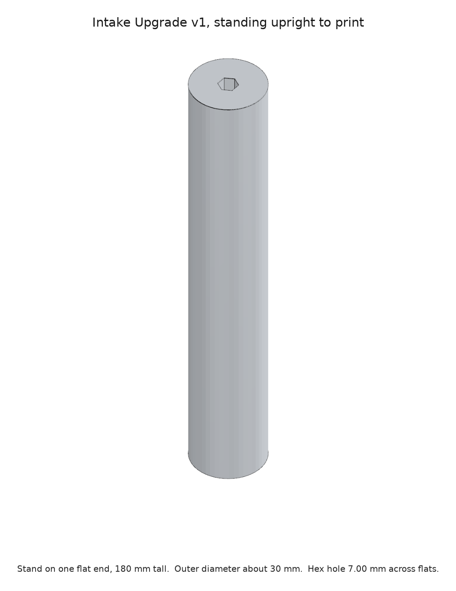
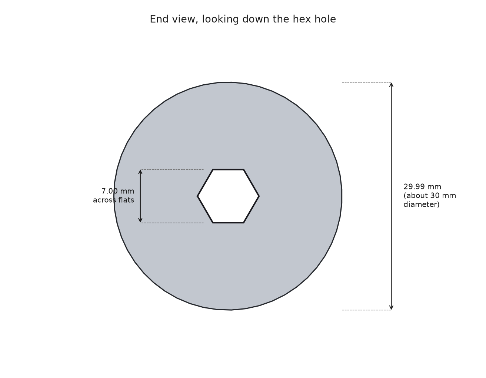

# Printing Guide: Intake Upgrade v1

This guide is for [`Intake Upgrade v1.stl`](./Intake%20Upgrade%20v1.stl) in this folder. We converted it from Aarav's 3MF file (opened in Bambu Studio, title `FTC_intake`). The 3MF has only one object, so this is a single STL, not a set of separate parts.

The notes below describe the shape of the part and how we recommend printing it. How the part is used on the robot is to confirm with Aarav.

## Previews

## What we measured

We loaded the 3MF in millimetres, as the file itself specifies. The mesh is watertight, with consistent outward normals. We did not need to flip or repair the normals.

| Measurement | Value |
|---|---|
| Length (print height) | 180.00 mm |
| Outer diameter (X) | 29.97 mm |
| Outer diameter (Y) | 29.99 mm |
| Outer diameter (designed) | about 30 mm |
| Hex hole, across flats | 7.00 mm |
| Hex hole, side length | 4.04 mm |
| Hex hole length | through the full 180.00 mm |
| Volume (solid) | 119.27 cm3 |
| Triangles | 636 |
| Vertices | 318 |
| Watertight | Yes |

A small note: the hex hole is about 0.06 mm off the centre line of the cylinder. That is very small, but we should still check the fit on the shaft.

## Recommended orientation

Print the roller standing on one flat end, with the long axis straight up, so the part is 180 mm tall. The STL in this folder is already standing this way (the bottom is at z = 0, the top is at z = 180 mm). If your slicer lays it down, rotate it so it stands on a flat end.

Why we print it this way:

- Each layer is a true circle, so the outer surface comes out round.
- The hex hole prints as a clean vertical hole, with no bridge and no supports.

### Risks, and how we reduce them

A tall, thin part (180 mm tall and about 30 mm across) can wobble or tip as it gets higher. To keep it stable:

- Use a 5 to 8 mm brim, so the base has more grip on the bed.
- Clean the bed, or use a glue stick, so the first layer holds well.
- Slow the outer walls, and reduce speed in the upper half of the print.
- Print one roller at a time, so the nozzle does not travel between parts and knock the roller over.

### Build height

The printer needs at least 180 mm of Z height. A Bambu Lab A1 mini is exactly 180 mm tall, so this part is right at the limit. Check the height in the slicer before we start, including the brim, and make sure the nozzle and the lid have room.

## Print settings

The 3MF was a Bambu Studio project for a Bambu Lab A1 mini, 0.4 mm nozzle, "0.20 mm Standard" profile, and a textured PEI plate. That profile had 15% infill and 2 walls, and supports were off. We should change the infill to 100% before we print. 100% infill (fully solid) is our standing rule for these kit parts.

| Setting | Our recommendation | Notes |
|---|---|---|
| Orientation | Standing on one flat end, 180 mm tall | Already set in the STL |
| Material | PETG or PLA | See the material section below |
| Layer height | 0.2 mm | Matches the 3MF |
| Walls | 3 or 4 | The 3MF had 2. Extra walls help the hex hole hold its shape |
| Infill | 100% (fully solid) | Please change this. The 3MF still has 15% |
| Infill pattern | gyroid or grid | At 100% the pattern matters less |
| Supports | None | The hex hole is vertical, so it needs no bridge and no supports |
| Brim | 5 to 8 mm | Helps a tall, thin part stay on the bed |
| Seam | Aligned or rear (optional) | Keeps the join line in one place down the side |
| Bed | Textured PEI, if you have it | As in the 3MF |
| First layer | Slow, with a good squish | Clean the bed, or use a glue stick |
| Outer walls and upper half | Slower than the default | Reduces wobble as the part gets taller |
| Nozzle | 0.4 mm | As in the 3MF |

## Material and temperatures

The 3MF has both PLA and PETG profiles loaded, and it looks like the plate was set to print in PETG. Please confirm with Aarav which filament to use. The starting temperatures below come from the 3MF profiles. If your spool lists different values, use those.

| Material | Nozzle | Bed (textured PEI) | Why we might choose it |
|---|---|---|---|
| PETG | 245 C | 70 C | Tougher, and a bit more heat resistant. Better if the roller takes load or wear |
| PLA | 220 C | 65 C | Easier to print, and easier to get a clean first layer |

## Filament use (estimated)

These numbers are from the solid mesh volume (119.27 cm3) at 100% infill. They do not include purge, prime, or the brim, so the real use will be a little higher.

| Material | Density used | Estimated mass |
|---|---|---|
| PLA | 1.24 g/cm3 | about 148 g |
| PETG | 1.27 g/cm3 | about 151 g |

## After printing: post-processing and fit check

1. Let the part cool on the bed before we remove it, so it does not bend or snap.
2. Peel the brim off carefully, so we do not damage the base.
3. Check the length with a ruler or calipers. We want 180 mm.
4. Check the outer diameter. We want about 30 mm, and it should feel round.
5. Check the hex hole, across flats, at both ends. We want about 7.00 mm.
6. Test that the hex shaft (exact size to confirm with Aarav) slides through the full length without forcing it. If the hole is tight, we can lightly sand the flats. Do not open it out so much that the shaft spins.
7. Look down the hole to check it is straight.
8. If we add foam around the roller, the planned sizes are in [Intake Calculations](./Intake%20Calculations.md). How the foam is fitted is to confirm with Aarav.
9. Test the fit on the robot before we glue or pin anything. The mounting is to confirm with Aarav.

## To confirm with Aarav

- Which filament to use, PLA or PETG.
- The exact hex shaft size that should go through the 7 mm hole.
- How the roller is mounted on the robot, and how any foam is fitted.
- Whether the 0.06 mm hole offset causes a real fit problem.
