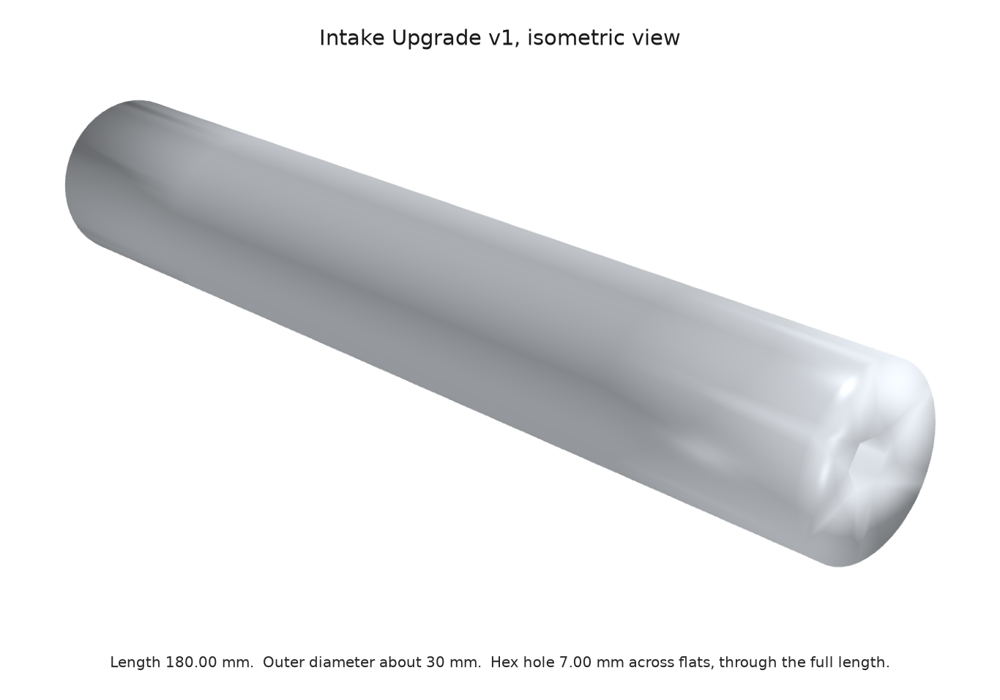

# Intake mechanism Upgrade, v1

This folder is the start of our intake mechanism upgrade, designed by Aarav Jaisingh.

## Files in this folder

| File | What it is |
|---|---|
| [Intake Upgrade v1.stl](./Intake%20Upgrade%20v1.stl) | The part to print. We converted it from Aarav's 3MF file. Units are mm. |
| [Printing Guide.md](./Printing%20Guide.md) | Size, print settings, filament estimate, and a fit-check list |
| [Intake Calculations.md](./Intake%20Calculations.md) | A typed, step by step walk-through of the handwritten calculation paper |
| [Intake calculations (handwritten).jpg](./Intake%20calculations%20(handwritten).jpg) | The original photo of the calculation paper |

## Preview

The part is a 180 mm long roller, about 30 mm in diameter, with a hexagonal hole (7.00 mm across flats) through its full length. Please see the [Printing Guide](./Printing%20Guide.md) for the full measurements and the print settings we recommend (100% infill).

The size notes for the hexagon, the 30 mm roller, the foam, and the 48 mm stock wheel are in [Intake Calculations.md](./Intake%20Calculations.md). How the roller is mounted on the robot is to confirm with Aarav.
