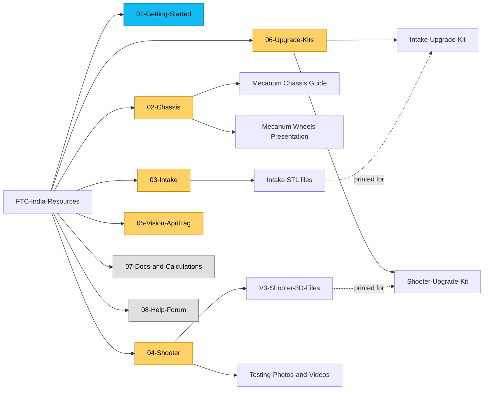

  

  
  
  
  

# FTC India Resources

Open designs, guides, code and maths to help FTC teams in India build a better robot, faster.

We started this in Bengaluru, but it is for every FTC team in India. We are students too, so please check our work and tell us when something is wrong.

---

## Quick start for new teams

1. Read [01-Getting-Started](./01-Getting-Started) for a step by step path.
2. Build a drive base with the [Mecanum Chassis Guide](./02-Chassis/Mecanum%20Chassis%20Guide.pdf).
3. Add the V3 shooter with the [V3 Shooting Assembly Guide](./06-Upgrade-Kits/Shooter-Upgrade-Kit/V3%20Shooting%20Assembly%20Guide.pdf).
4. Add the intake with the [Intake Assembly Guide](./06-Upgrade-Kits/Intake-Upgrade-Kit/Intake%20Assembly%20Guide.pdf).
5. Add a camera with the [Camera Integration Plan](./05-Vision-AprilTag/Camera%20Integration%20Plan.md).
6. Stuck? Read the [Help Forum](./08-Help-Forum/README.md) or ask us with the [question form](https://forms.gle/SyWnmo3xL4crevMCA).

Print every part at 100% infill.

---

## What is in this repository

| Folder | What's inside | Start here |
|---|---|---|
| [01-Getting-Started](./01-Getting-Started) | Suggested path for new teams, setup and tips | [README](./01-Getting-Started/README.md) |
| [02-Chassis](./02-Chassis) | Mecanum chassis guide and the Mecanum Wheels Presentation | [Mecanum Chassis Guide.pdf](./02-Chassis/Mecanum%20Chassis%20Guide.pdf) |
| [03-Intake](./03-Intake) | Intake roller STL files, printing guide and calculations | [v1 by Aarav Jaisingh.md](./03-Intake/v1%20by%20Aarav%20Jaisingh.md) |
| [04-Shooter](./04-Shooter) | V3 shooter print files, theory PDF, build photos and video | [V3-Shooter-3D-Files](./04-Shooter/V3-Shooter-3D-Files) |
| [05-Vision-AprilTag](./05-Vision-AprilTag) | Camera buying guide, Java AprilTag plan and starter code, Python app | [Camera Integration Plan.md](./05-Vision-AprilTag/Camera%20Integration%20Plan.md) |
| [06-Upgrade-Kits](./06-Upgrade-Kits) | Shooter and intake upgrade kits with assembly guides and parts lists | [README](./06-Upgrade-Kits/README.md) |
| [07-Docs-and-Calculations](./07-Docs-and-Calculations) | Strategy guide and full shooter trajectory maths | [Shooter Trajectory Calculations.md](./07-Docs-and-Calculations/Shooter%20Trajectory%20Calculations.md) |
| [08-Help-Forum](./08-Help-Forum) | FAQs, basics, common mistakes, troubleshooting and a glossary | [README](./08-Help-Forum/README.md) |
| [assets](./assets) | Images used in this README | [banner.svg](./assets/banner.svg) |

### Repository layout

---

## 02 Chassis

The chassis is the base for everything else. We use a mecanum drive.

| Chassis type | Strength | Best for |
|---|---|---|
| Mecanum drive | Moves in every direction | Precise alignment and scoring |
| Tank drive | Strong pushing power, simple build | Rookie teams and defence |
| Hybrid or custom | Mix of speed and control | Teams with experience |

- **[Mecanum Chassis Guide](./02-Chassis/Mecanum%20Chassis%20Guide.pdf)** (15 pages, [summary](./02-Chassis/Mecanum%20Chassis%20Guide.md)). A goBILDA style build with a U-channel frame, 4 x 104 mm GripForce mecanum wheels and 312 RPM Yellow Jacket motors. It covers the parts list, the X roller pattern, wiring, configuration names, motor directions, robot-centric and field-centric Java code, and a first drive checklist. We have not built and tested this exact chassis yet.

### Mecanum Wheels Presentation

A 21 slide deck by Aarav J. on what mecanum wheels are, why they help in FTC, and how to program them. It has animated examples that compare tank drive and mecanum drive. The times in those examples are illustrative, not measured.

| Format | Link |
|---|---|
| Google Slides | [Open the deck](https://docs.google.com/presentation/d/10t6m5lrtCYghSzNBLcLgv_6zWi-kxssT0vhTHXqJd7Y/edit) |
| PDF | [Mecanum Wheels Presentation.pdf](./02-Chassis/Mecanum%20Wheels%20Presentation.pdf) |
| PowerPoint | [Mecanum Wheels Presentation.pptx](./02-Chassis/Mecanum%20Wheels%20Presentation.pptx) |

---

## 03 Intake

The v1 intake roller is 180 mm long, about 30 mm across, with a 7 mm hex hole through its length. Start with [v1 by Aarav Jaisingh](./03-Intake/v1%20by%20Aarav%20Jaisingh.md). The [Printing Guide](./03-Intake/Printing%20Guide.md) has the print settings, and [Intake Calculations](./03-Intake/Intake%20Calculations.md) explains the sizes. The intake is not tested on a robot yet.

---

## 04 Shooter

The V3 shooter is designed for repeatable shots. A shooter that scores 9 out of 10 times is worth more than a fast one that scores 5 out of 10.

| # | File | Part | Size |
|---|---|---|---|
| 1 | `FTC Shooter V3 Rail Guard.stl` | V3 rail guard (main shooter) | about 217 x 88 x 116 mm |
| 2 | `prolabs_plain_sheet_0p2.stl` | OP2 (flex) sheet, print 2 | 88 x 104 x 0.2 mm |
| 3 | `plate_368_cut_5x5.stl` | Plate 368 replacement | 40 x 40 x 1.5 mm |

All three are in [04-Shooter/V3-Shooter-3D-Files](./04-Shooter/V3-Shooter-3D-Files). Print the rail guard sideways with no supports, so the shooter curve stays smooth. Print the sheet and plate flat. Photos and a walkaround video are in [Testing-Photos-and-Videos](./04-Shooter/Testing-Photos-and-Videos).

> Built on a robot, but not shooting tested yet. Fit numbers are from CAD.

There is also an [interactive shooter simulator](https://ftc-shooter-interactive-guide.netlify.app/) that compares V3 with the older V2.

---

## 05 Vision and AprilTag

A camera can find the AprilTags on the field and tell the robot where it is. This helps most in Autonomous.

- Pick a webcam with the [Camera buying Guide](./05-Vision-AprilTag/Camera%20buying%20Guide.md).
- Move to Java on FTC SDK v12.0 with the [Camera Integration Plan](./05-Vision-AprilTag/Camera%20Integration%20Plan.md) and the starter OpMode [CameraAimTeleOp.java](./05-Vision-AprilTag/CameraAimTeleOp.java). Not robot tested yet.
- Try ideas on a laptop with [FTC-camera(v1).py](./05-Vision-AprilTag/FTC-camera%28v1%29.py).

---

## 06 Upgrade Kits

| Kit | What is in the kit | Guide |
|---|---|---|
| [Shooter-Upgrade-Kit](./06-Upgrade-Kits/Shooter-Upgrade-Kit) | 1 V3 shooter, 2 Plate 368 (1 spare), 2 OP2 sheets, electrical tape, zip ties, a small bottle of super glue | [V3 Shooting Assembly Guide](./06-Upgrade-Kits/Shooter-Upgrade-Kit/V3%20Shooting%20Assembly%20Guide.pdf) (27 pages, 15 steps) |
| [Intake-Upgrade-Kit](./06-Upgrade-Kits/Intake-Upgrade-Kit) | 1 FTC intake attachment, foam, zip ties | [Intake Assembly Guide](./06-Upgrade-Kits/Intake-Upgrade-Kit/Intake%20Assembly%20Guide.pdf) (13 pages, 7 steps) |

For the intake kit, we mount the attachment on the intake hex shaft, then wrap the foam around it, layer by layer, until it reaches the POLLEN.

---

## 07 Docs and Calculations

- [FTC_Shooting_and_Intake_Mechanism.pdf](./07-Docs-and-Calculations/FTC_Shooting_and_Intake_Mechanism.pdf): strategy guide for the shooter and intake.
- [Shooter Trajectory Calculations](./07-Docs-and-Calculations/Shooter%20Trajectory%20Calculations.md): projectile motion, hood angle and launch speed, the CELL error window, flywheel RPM recovery, air drag and backspin, and shooting while moving, with a worked example and Python.

Key ideas: design the full cycle (pick up, transfer, aim, shoot), cut cycle time, and make it reliable first.

---

## 08 Help Forum

The [Help Forum](./08-Help-Forum/README.md) has FAQs, basics, common mistakes, troubleshooting and a glossary.

Have a question that is not answered there? Please ask us with the **[question form](https://forms.gle/SyWnmo3xL4crevMCA)**. It helps if you include:

- What you are trying to build
- What you have tried so far
- Photos or code snippets if possible

---

## Contributing

Found a mistake or have a better design? We would be glad to have your help.

1. Fork this repository.
2. Create a new branch for your change.
3. Put your files in the matching numbered folder, and add them to that folder's README.
4. Open a pull request that explains what you added and why.

Please use simple English and say clearly what is tested and what is not.

---

## Roadmap

| Planned addition | Status |
|---|---|
| Mecanum chassis guide | Done. Not built and tested by us yet |
| V3 shooter files, BOM and assembly guide | Done. Shooting test videos planned |
| Intake Upgrade Kit and assembly guide | Done. Not tested on a robot yet |
| AprilTag camera buying guide and Java plan | Done. Java not robot tested yet |
| More chassis CAD files | Planned |
| Improved AprilTag code (v2) | Planned |
| Autonomous path examples | Planned |
| Video build guides | Planned |

---

## Credits

| Role | Name |
|---|---|
| Created by | Aarav J. |
| In collaboration with | Team R- Factor (FRC), led by Nilesh Shah |

Thank you to every team and mentor who shares knowledge openly.

---

## License

This project is under the MIT License. See the [LICENSE](./LICENSE) file for details.
